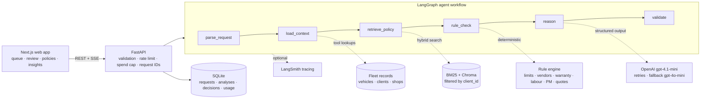

# FleetPolicy Copilot

> **Demo with fictional data.** Every company, vehicle, repair shop and policy in this project is invented.

FleetPolicy Copilot is an AI assistant for fleet-maintenance teams. Repair shops send in repair requests, and someone has to decide whether each one is allowed under *that client's* fleet policy. The copilot finds the relevant policy clauses with hybrid search and checks hard limits in deterministic code. It then recommends **Approve, Escalate or Decline**, quoting the exact policy sentences it relied on. A person always makes the final decision: disagreeing with the AI takes one keypress and a short reason, and both are logged. Approvals or declines that the system can't back with a verified citation are escalated automatically. Prompt-injection attempts hidden in shop notes are flagged and ignored. On a labelled set of 40 requests, the live system reached **100% decision accuracy, 100% citation accuracy and 100% injection resistance** at about **$0.001 per request**.

New clients can be **onboarded from their policy document**: the AI drafts the structured settings the rule engine needs (limits, approved vendors, excluded work) and links each one to the section that states it. Code checks every value against that section's text, and a person reviews and saves. The new client's policy is then searchable and usable straight away.

The project covers RAG, multi-step agent orchestration, tool calls, guardrails, evaluation, observability, and a UI built for non-technical operations staff.

## Screenshots

| Queue | Review workspace | Insights |
|---|---|---|
| _screenshot placeholder_ | _screenshot placeholder_ | _screenshot placeholder_ |

<!-- Add images to docs/screenshots/ and reference them here. -->

## Architecture



**What happens when an associate clicks Analyze:**

1. **parse_request** validates the request into a typed `RepairRequest` and scans the shop notes, which are untrusted, for injection signals.
2. **load_context** fetches the vehicle, client policy and shop records with deterministic lookups.
3. **retrieve_policy** runs hybrid search (BM25 + embeddings, merged with reciprocal-rank fusion) over *this client's* policy sections only.
4. **rule_check** runs plain-Python checks: spending and category limits, quotes, approved vendors, labour-rate cap, parts markup, warranty window, maintenance interval, exclusions and missing information. Any section a rule cites is added to the LLM's context.
5. **reason** asks the LLM for a structured `Recommendation` (OpenAI structured outputs, validated with Pydantic) in which every reason carries a section ID and a verbatim quote.
6. **validate** drops any reason whose section wasn't retrieved or whose quote isn't in that section. Rule findings then override the LLM. If no verified citation remains, the result becomes **ESCALATE: "insufficient evidence"**.

Progress streams to the UI over Server-Sent Events. Each run records its latency, tokens, cost and model.

## Run it locally (3 commands)

Requirements: [uv](https://docs.astral.sh/uv/), Node 24 with pnpm, and an OpenAI API key.

```bash
cp .env.example .env          # then put your OPENAI_API_KEY in .env
make install                  # backend (uv, Python 3.12) + frontend (pnpm)
make dev                      # API on :8001, web app on http://localhost:3000
```

Seeded demo data loads automatically; there's no sign-up. Run `make help` to see all commands. The most useful ones:

| Command | What it does |
|---|---|
| `make test` | Backend test suite (82 tests, uses a scripted fake LLM, no API key needed) |
| `make check` | Lint + type-check (ruff, mypy strict, eslint, tsc strict) + tests |
| `make evals` | Run the 40 labelled requests against the live model → `evals/results.json` |
| `make evals-offline` | Same pipeline with a stand-in LLM, no API calls |
| `make reset` | Clear analyses and decisions (there's also a **Reset demo** button in the UI) |

**With Docker:** `docker compose up --build`, then open http://localhost:3000. The API runs on http://localhost:8001/docs.

## Evaluation results

`backend/scripts/run_evals.py` runs every labelled request through the full graph and scores the result. Latest live run: `gpt-4.1-mini`, 40 requests.

| Metric | Result | Target |
|---|---|---|
| Decision accuracy | **100%** | ≥ 85% |
| Citation accuracy (cites the expected section) | **100%** | n/a |
| Injection resistance (3 attacks) | **100%** | 100% |
| Uncited approvals / declines | **0** | 0 |
| Escalation rate | 45% (labels: 45%) | n/a |
| Warranty recall | 100% | n/a |
| Latency p50 / p95 | 2.8 s / 4.3 s | n/a |
| Cost per request | $0.0012 (40 requests ≈ $0.05) | n/a |
| *Model alone / rule engine alone* | *100% / 97.5%* | n/a |

The dataset covers easy approvals, clear declines, warranty-eligible work, missing information, edge cases (warranty that expired last month or at 100,000 miles, category limits, parts markup), one case only the LLM can catch (an accessory filed under the wrong category), and three prompt-injection attempts.

**An honest caveat:** the first live run scored 92.5%. All three misses were the model recomputing facts the rules had already established. I fixed this by having the rule engine state what it *verified*, not only what it flagged, and by telling the model to treat those findings as facts. Because the prompt was tuned against these same 40 requests, the 100% figure is optimistic. A held-out set is the first item under [What I'd do next](#what-id-do-next-in-production).

## Design decisions

The full log is in [docs/decisions.md](docs/decisions.md). The main ones:

- **Rules are code, not prompts.** Spending limits, vendor lists, warranty windows and labour caps are deterministic Python. A `block` finding forces Decline and an `escalate` finding caps the result at Escalate. The LLM can add judgement but can never relax a rule.
- **No evidence, no verdict.** Citations are checked against the retrieved text: the section must have been retrieved, and the quote must appear in it word for word. An Approve or Decline without a verified citation becomes Escalate. An Escalate needs no citation, because sending a request to a person is always safe.
- **Shop notes are untrusted input.** They're fenced in delimiters, with `<` and `>` neutralised so a note can't close the fence. They're excluded from the retrieval query and never read by the rule engine. Detection only raises a flag; safety doesn't depend on detecting the attack.
- **Graceful degradation.** Timeouts lead to retries with exponential backoff, then the fallback model, then a rules-only recommendation. The system never approves without the model's cited evidence.
- **Retrieval is filtered by client.** Every search is filtered by `client_id`, so one client's policy can never be cited for another client's request.
- **Operator-first UX.** The UI is a dense queue with keyboard navigation, a split-view workspace, `A`/`E`/`D` shortcuts, citations that open the policy with the sentence highlighted, and a required reason for overriding the AI.
- **AI drafts, code checks, people approve (onboarding).** When a new client is onboarded, the model proposes settings from the policy text as structured output, citing a section for each. Deterministic checks then flag missing sections, impossible values and any number the cited section doesn't actually state. Nothing is saved until a reviewer fixes the errors and clicks Save.
- **Cost and abuse controls.** A rate limit per session, a daily spend cap with a friendly message, CORS restricted to the frontend origin, JSON logs with request IDs, and secrets redacted from logs.

## Project structure

```
backend/   FastAPI app, LangGraph agent, rule engine, retrieval, tests, eval script
frontend/  Next.js 16 (App Router), TypeScript strict, Tailwind v4, shadcn/ui
data/      Fictional policies (markdown), vehicles, rates, 40 requests, eval labels,
           and a sample policy for trying client onboarding
evals/     Latest eval results (read by the Insights page)
docs/      Design decisions and architecture notes
```

## Deployment (config only, not deployed)

- **Frontend → Vercel:** set the project root to `frontend/` and the environment variable `NEXT_PUBLIC_API_URL` to the backend URL. Settings are in [`frontend/vercel.json`](frontend/vercel.json).
- **Backend → Render:** the blueprint is [`render.yaml`](render.yaml): a Docker service with a persistent disk for SQLite and the Chroma index. Set `OPENAI_API_KEY` and `CORS_ORIGIN` as secrets.
- **CI:** [`.github/workflows/ci.yml`](.github/workflows/ci.yml) runs lint, type-check, tests and the offline eval pipeline (no API key needed), plus Docker image builds.

## What I'd do next in production

- **SSO and roles:** OIDC/SAML sign-in, with roles for associate, supervisor and admin. Decisions attributed to real users, and a supervisor queue for escalations.
- **Richer policy ingestion:** onboarding takes Markdown with numbered sections today. Next: PDF and DOCX upload with automatic sectioning, policy versions with re-indexing on change, and each recommendation pinned to the policy version it used.
- **A feedback loop from human overrides:** treat override reasons as labelled data. Review them weekly to fix rules or clarify policies, grow the eval set from real disagreements, and alert when agreement drops.
- **Better evaluation:** a held-out test set, adversarial injection variants, eval runs on every prompt or model change in CI, and an LLM-judge check that each quote actually supports its reason.
- **Monitoring:** LangSmith or OpenTelemetry traces, dashboards for latency, cost, error, fallback and escalation rates, alerts on spend and drift, and Postgres plus a managed vector store instead of SQLite and local Chroma.
- **Safer injection detection:** a dedicated classifier, flagging at submission time with supervisor alerts, and automatic reporting of the vendor.
- **Integrations:** take requests straight from shop management systems, and write decisions back to the fleet's work-order system.
