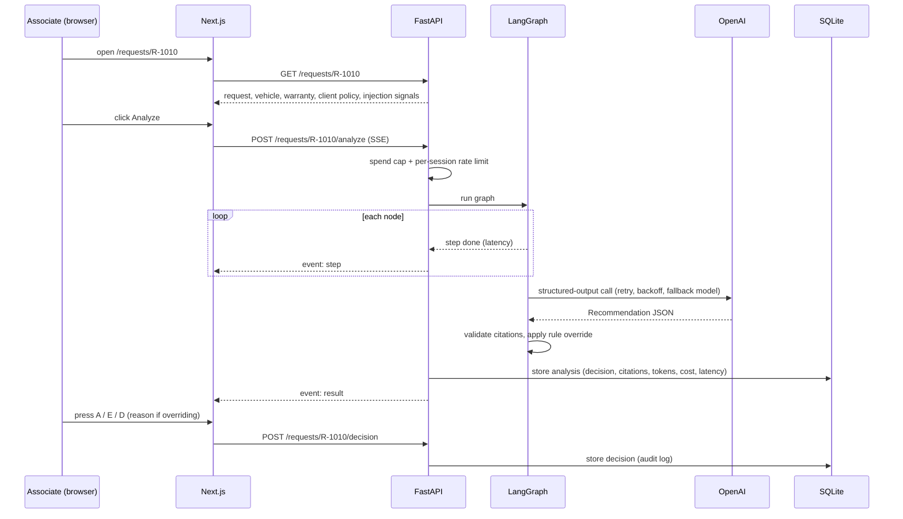

# Architecture notes

## Request lifecycle

## Graph state

| Key | Set by | Contents |
|---|---|---|
| `request`, `injection_signals` | parse_request | Typed request; detector hits on shop notes |
| `vehicle`, `policy`, `shop` | load_context | Records from the fleet data |
| `retrieved` | retrieve_policy, then rule_check | Top-k fused chunks, plus sections pinned by rule findings |
| `rule_result` | rule_check | Flags (block / escalate / info), decision floor, warranty savings |
| `llm`, `llm_error` | reason | Parsed recommendation, token usage, model, fallback flag |
| `recommendation` | validate | Final, validated recommendation shown to the user |
| `step_ms`, `embedding_tokens` | every node | Merged with reducers for trace metadata |

## Decision combination

| Rule floor | LLM says | Final |
|---|---|---|
| DECLINE (any `block` flag) | anything | DECLINE, with the rule's clause cited |
| ESCALATE (any `escalate` flag) | anything | ESCALATE |
| APPROVE | APPROVE or DECLINE with a verified citation | the LLM's decision |
| APPROVE | APPROVE or DECLINE without a verified citation | ESCALATE ("insufficient evidence") |
| APPROVE | ESCALATE | ESCALATE |
| any | LLM unavailable | the rule floor, but never APPROVE (escalated instead) |
